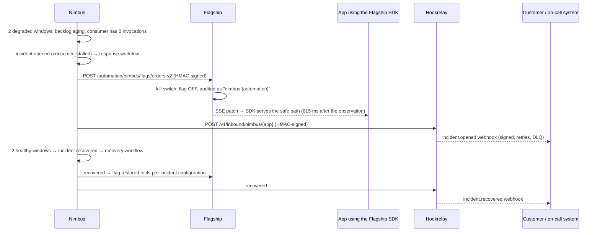

# Atalaya

**A developer infrastructure platform made of three independent products that work together.** *Atalaya* is Spanish for watchtower.


| Product | Problem it solves | Stack | Repo |
|---|---|---|---|
| **Hookrelay** | Deliver events to customer systems reliably: signatures, retries, dead-letter queue, replay | NestJS, BullMQ, PostgreSQL, Redis, Next.js | [DRTX2/hookrelay](https://github.com/DRTX2/hookrelay) |
| **Flagship** | Control who gets which behaviour, changed live: targeting, rollouts, kill switches, local evaluation | NestJS, Angular, TypeScript SDK, PostgreSQL | [DRTX2/flagship](https://github.com/DRTX2/flagship) |
| **Nimbus** | Detect and explain failures in AWS async pipelines (SQS, Lambda, DLQ) and run a governed response | Go, PostgreSQL, React | [DRTX2/nimbus](https://github.com/DRTX2/nimbus) |

Each product has its own repository, database, pipeline and release cycle, and each is useful alone. Together they close a loop that teams usually wire by hand: **detect → mitigate → notify → recover**.

## The scenario (runs locally, asserted end to end)



```bash
# the three product repos must sit next to this one: ../hookrelay ../flagship ../nimbus
docker compose up -d --wait
node demo.mjs          # Node 24+, no dependencies
```

Real output of the last run is in [docs/demo-output.txt](docs/demo-output.txt):

```
4. The consumer stalls: two degraded windows (backlog 200, oldest message 10 min, 0 invocations)
   ✓ Nimbus opened incident … (consumer_stalled)
   ✓ Flagship turned orders-v2 OFF; the SDK saw it 615 ms after the observation
   ✓ audit: "nimbus (automation)" killed by nimbus incident …: Queue backlog is aging while the Lambda consumer has no invocations
   ✓ Hookrelay delivered incident.opened to the customer endpoint (signed, with retries/DLQ behind it)
5. The consumer recovers: two healthy windows
   ✓ Flagship restored orders-v2 to its pre-incident configuration
   ✓ Hookrelay delivered incident.recovered
```

Dashboards while it runs: Hookrelay API docs <http://localhost:3000/docs> · Flagship <http://localhost:4000> (token `change-me`) · Nimbus <http://localhost:8080/app/>.

## How the products are joined (and how they are not)

| Rule | Why |
|---|---|
| **Integration is by public HTTP APIs only.** No shared database, queue or code | Each product stays deployable and testable alone |
| **Every integration is optional.** Unset the env var and it's off | No product's core promise depends on another being up |
| **Requests between products are HMAC-signed** with a shared secret and a 5-minute replay window | Nimbus HTTP steps can't carry API keys, and callers must be authenticated |
| **Every hop is idempotent** (keys derived from incident id, flag version) | All three products deliver at-least-once; retries must be harmless |
| **Humans win over automation** | Flagship only restores a flag if nobody touched it since the incident's kill |

Details and failure modes: [docs/ARCHITECTURE.md](docs/ARCHITECTURE.md).

## What is deliberately not built
A shared platform layer (single sign-on, organizations, billing) would come next if this were one commercial offering. It's left out on purpose: it's generic work that doesn't change what each product demonstrates, and coupling identity early would make the products harder to run independently. The right shape, when needed, is a separate OIDC identity service that all three trust. Nimbus already accepts OIDC tokens.

## Status
- The scenario above passes locally with all three products in Docker.
- Each integration point is covered in its own repo's test suite (Flagship: signed kill/restore, replay window, human-override rule. Hookrelay: signed inbound, idempotency, delivery).
- Not deployed to a cloud account yet. Hookrelay and Flagship ship Terraform for AWS ECS; Nimbus ships its own.
