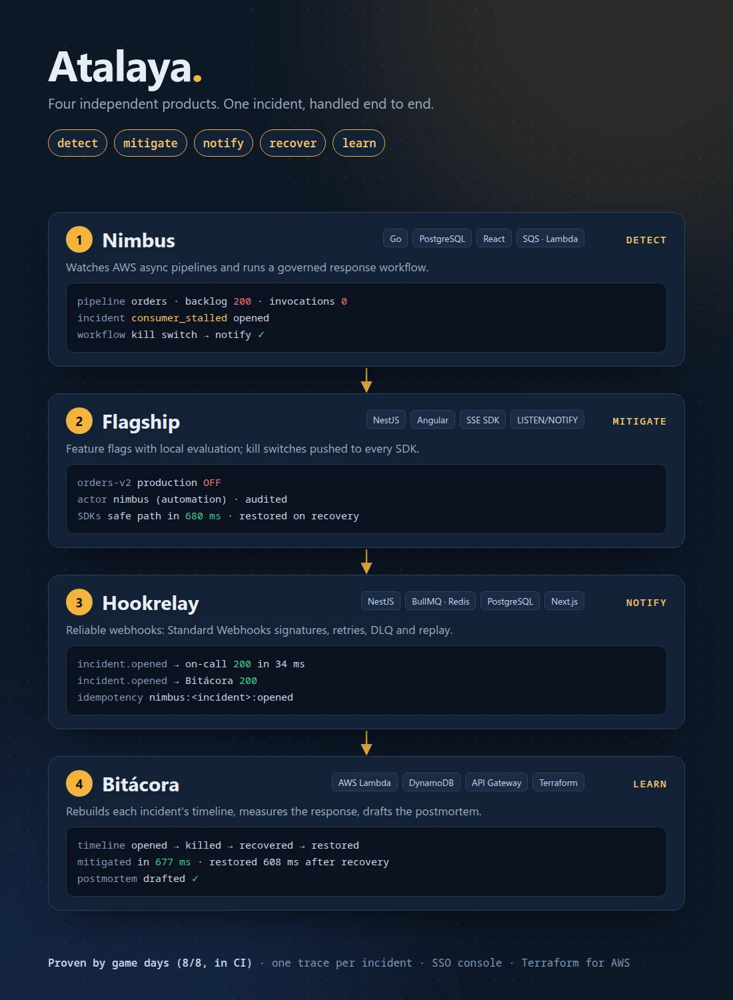
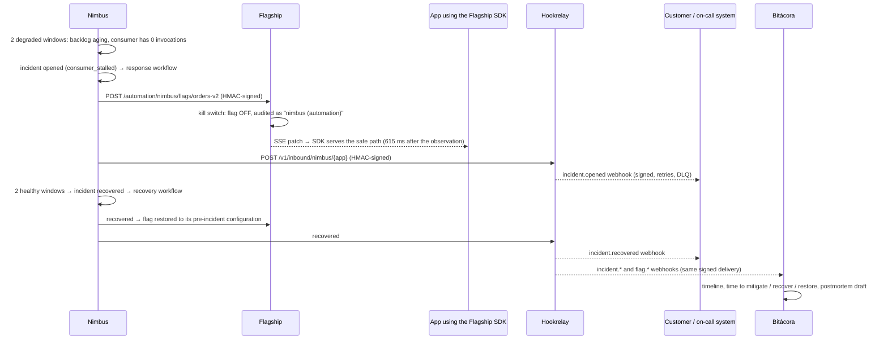

# Atalaya

**A developer infrastructure platform made of four independent products that work together.** *Atalaya* is Spanish for watchtower.



| Product | Problem it solves | Stack | Repo |
|---|---|---|---|
| **Hookrelay** | Deliver events to customer systems reliably: signatures, retries, dead-letter queue, replay | NestJS, BullMQ, PostgreSQL, Redis, Next.js | [DRTX2/hookrelay](https://github.com/DRTX2/hookrelay) |
| **Flagship** | Control who gets which behaviour, changed live: targeting, rollouts, kill switches, local evaluation | NestJS, Angular, TypeScript SDK, PostgreSQL | [DRTX2/flagship](https://github.com/DRTX2/flagship) |
| **Nimbus** | Detect and explain failures in AWS async pipelines (SQS, Lambda, DLQ) and run a governed response | Go, PostgreSQL, React | [DRTX2/nimbus](https://github.com/DRTX2/nimbus) |
| **Bitácora** | Rebuild each incident's timeline from the webhooks, measure the response, draft the postmortem | AWS Lambda, DynamoDB, API Gateway, TypeScript | [DRTX2/bitacora](https://github.com/DRTX2/bitacora) |

Each product has its own repository, database, pipeline and release cycle, and each is useful alone. Together they close a loop that teams usually wire by hand: **detect → mitigate → notify → recover → learn**.

## The scenario (runs locally, asserted end to end)



```bash
# the three product repos must sit next to this one: ../hookrelay ../flagship ../nimbus
docker compose up -d --wait
node demo.mjs          # Node 24+, no dependencies
```

`docker compose up` also runs `bootstrap.mjs` once: it creates the platform's Hookrelay tenant, hands its API key to Flagship (through a file, the Docker secrets convention) so flag changes are published, and subscribes Bitácora to `incident.*` and `flag.*`. It is idempotent and repairs only the side that lost its data.

Real output of the last run is in [docs/demo-output.txt](docs/demo-output.txt):

```
4. The consumer stalls: two degraded windows (backlog 200, oldest message 10 min, 0 invocations)
   ✓ Nimbus opened incident … (consumer_stalled)
   ✓ Flagship turned orders-v2 OFF; the SDK saw it 680 ms after the observation
   ✓ audit: "nimbus (automation)" killed by nimbus incident …: Queue backlog is aging while the Lambda consumer has no invocations
   ✓ Hookrelay delivered incident.opened to the customer endpoint (signed, with retries/DLQ behind it)
5. The consumer recovers: two healthy windows
   ✓ Flagship restored orders-v2 to its pre-incident configuration
   ✓ Hookrelay delivered incident.recovered
6. Bitácora rebuilt the incident from the webhooks Hookrelay delivered to it
   ✓ timeline: incident.opened -> flag.killed -> incident.recovered -> flag.restored
   ✓ metrics: mitigated in 677 ms, recovered in 1.1 s, flag restored 608 ms after recovery
   ✓ postmortem drafted (saved to docs/postmortem-example.md)
```

The demo posts the metric windows back to back, so "recovered in 1.1 s" stands for what would be minutes in production. The postmortem Bitácora wrote for that run: [docs/postmortem-example.md](docs/postmortem-example.md).

**Atalaya Console: <http://localhost:3100>.** One incident view across the four products. Each product's own UI is still there: Hookrelay API docs <http://localhost:3000/docs> · Flagship <http://localhost:4000> (token `change-me`) · Nimbus <http://localhost:8080/app/> · Bitácora API <http://localhost:8090/incidents> (token `change-me`).

## Game days: the failure modes are tested, not claimed

```bash
node chaos/run.mjs        # 8 declarative chaos experiments, ~10 min, report in chaos/reports/latest.md
```

Every link between the products goes through Toxiproxy. Each experiment breaks one link (down or slow) at a chosen moment of an incident and checks a claim from [ARCHITECTURE.md](docs/ARCHITECTURE.md) against real product data: the SDK's view of the flag, Hookrelay's delivery attempts and DLQ, Bitácora's timeline. A steady-state check runs first, a time budget aborts runaway experiments, and links are always healed.

**The first game day passed 2 of 5.** It found three real defects that every per-repo suite missed, because each one mocks its neighbours:

| Experiment | Defect found | Fix |
|---|---|---|
| `flagship-blip` | A 15 s Flagship restart meant the flag was **never killed**: Nimbus' default retries give up after ~6 s | ~90 s retry budget for the (idempotent) response steps |
| `publish-path-down` | A flag change was **lost** when Hookrelay was unreachable for 10 s: Flagship published fire-and-forget | Transactional outbox in Flagship ([ADR-0007](https://github.com/DRTX2/flagship/blob/main/docs/adr/0007-transactional-outbox.md)) |
| `bitacora-down` | After a DLQ replay, Bitácora **dropped the restore** because it arrived before its kill | Per-flag history that links follow-ups to their kill in any order |

**The second game day broke the real app** (k6 customers, SQS, a Lambda-style consumer, real queue metrics) and stopped processes and databases, not only links. It found four more:

| Experiment | Defect found | Fix |
|---|---|---|
| `orders-flagship-db-down` | Flagship (and Hookrelay) **crashed** when the database dropped idle connections | Pool error handler; regression test kills every backend connection |
| `orders-flagship-db-down` | After a failover, SDKs **stopped receiving changes**: LISTEN retried once | Reconnect with backoff, resync SDKs, `flagship_listen_connected` gauge |
| `orders-*` | Test tooling **rotated the production SDK key** in use, revoking the app's key on its next reconnect | Scenarios reuse the key |
| `orders-consumer-crash` | Customers failed client-side (stale DNS) while the server counted zero failures | k6 resolves DNS per request; steady state requires live traffic |

And when mitigation cannot happen at all (`flagship-unreachable`), Nimbus now **escalates** to on-call instead of failing silently. All 8 pass, locally and in CI ([`game-day.yml`](.github/workflows/game-day.yml)). Details: [docs/GAME_DAYS.md](docs/GAME_DAYS.md).

## Tracing: one incident, one trace

Every product propagates W3C `traceparent`, including through Flagship's outbox and Hookrelay's job queue. Nimbus uses the incident ID as the trace ID, so the whole response (kill switch, notifications, deliveries, Bitácora's DynamoDB writes, restore) is a single trace in Jaeger (:16686), linked from the console's incident page.

## Atalaya Console

A Next.js 16 BFF (`console/`) that reads the four products' APIs server-side (tokens never reach the browser) and shows:
- **Overview:** open incidents, time to mitigate and recover (p50/p95), webhook success rate, dead letters, last game day.
- **Incident:** one timeline merged from Nimbus (detection evidence, open/recover), Flagship (kill and restore from its audit log), Hookrelay (every delivery attempt per endpoint) and Bitácora (metrics and the postmortem draft).
- **Game days:** each experiment's hypothesis, faults and observed results.

- **Respond (operators):** acknowledge in Nimbus, resend failed deliveries, turn a flag on or off, each one audited with the person's name.
- **Audit:** who did what from the console.

Sign-in is OIDC (Authorization Code + PKCE) against Keycloak in the stack (:8180): `olivia` / `operator` acts, `victor` / `viewer` reads. Deep links survive sign-in, every read and action is authorized on the server, and the session is a signed httpOnly cookie. If one product is down, only its panel degrades. The timeline merge, role rules, input validation and the postmortem renderer (which escapes all HTML from incident data) are unit-tested; sign-in, roles and actions are checked in a real browser.

## How the products are joined (and how they are not)

| Rule | Why |
|---|---|
| **Integration is by public HTTP APIs only.** No shared database, queue or code | Each product stays deployable and testable alone |
| **Every integration is optional.** Unset the env var and it's off | No product's core promise depends on another being up |
| **Requests between products are HMAC-signed** with a shared secret and a 5-minute replay window | Nimbus HTTP steps can't carry API keys, and callers must be authenticated |
| **Every hop is idempotent** (keys derived from incident id, flag version) | All three products deliver at-least-once; retries must be harmless |
| **Humans win over automation** | Flagship only restores a flag if nobody touched it since the incident's kill |

Details and failure modes: [docs/ARCHITECTURE.md](docs/ARCHITECTURE.md).

## What is deliberately not built
Organizations and billing. Identity stops at the console: the products keep their own service credentials instead of trusting the IdP directly, so each one still runs alone. Nimbus already accepts OIDC tokens if that step is ever needed.

## Status
- The scenario above passes locally with all four products in Docker, and the game day passes 8 of 8 (also in CI).
- Each integration point is covered in its own repo's test suite (Flagship: signed kill/restore, replay window, human-override rule, key read from a file. Hookrelay: signed inbound, idempotency, delivery. Nimbus: `occurredAt` on incident events. Bitácora: out-of-order and duplicate deliveries against real DynamoDB).
- Not deployed to a cloud account yet: [`deploy/aws`](deploy/aws/README.md) is prepared (budget first, ≈0.30 USD/hour, one-command teardown) and waiting for an account.
