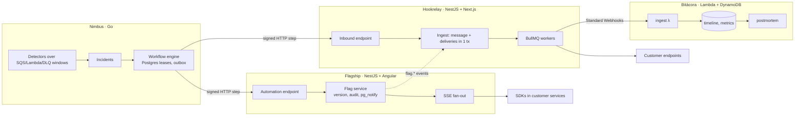

# Atalaya architecture

## Shape

Four codebases, three PostgreSQL databases (plus Redis for Hookrelay) and one DynamoDB table, one Docker network in `compose.yaml`. Nothing is shared except a signing secret; `bootstrap.mjs` does the one-time wiring an operator would do (tenant, API key, subscription).

## Integration contracts

### Nimbus → Flagship: `POST /automation/nimbus/flags/{key}/envs/{env}`
- Body: the Nimbus incident event (`incidentId`, `event: opened|recovered`, `pipelineName`, `summary`, …).
- Auth: `Nimbus-Signature: t=<unix>,v1=<hex>` = HMAC-SHA256(`NIMBUS_WEBHOOK_SECRET`, `<unix>.<raw body>`). Rejected outside ±300 s. Several `v1` values allow secret rotation.
- `opened`: if the flag is on, turn it off through the normal write path (validation, version bump, audit entry `killed by nimbus incident <id>`, `pg_notify`, SSE). Already off → no-op.
- `recovered`: restore the configuration from before that kill **only if the latest audit entry is still that kill**. Otherwise no-op.
- Always `200` with `{ changed, action | reason }`, so a workflow step succeeds on replays.

### Nimbus → Hookrelay: `POST /v1/inbound/nimbus/{appId}`
- Same signature scheme. The incident becomes a message `incident.opened` / `incident.recovered` for that tenant.
- Idempotency key `nimbus:<incidentId>:<event>`: a replayed step returns the original message and schedules nothing.
- From there it's ordinary Hookrelay delivery: per-endpoint Standard Webhooks signature, retries with backoff, circuit breaker, DLQ, replay.

### Flagship → Hookrelay (optional): `POST /v1/messages`
- After each committed flag change: `flag.created | flag.updated | flag.archived`, bearer API key, idempotency key `flagship:<type>:<flag>:<env>:<version>`.
- Written to a transactional outbox in the same transaction as the change, then delivered with retries: never lost, never blocks a flag change (the `publish-path-down` game day found the earlier fire-and-forget version lost events).

### Hookrelay → Bitácora: `POST /webhooks/hookrelay/{sourceId}`
- An ordinary Hookrelay endpoint subscribed to `incident.*` and `flag.*`. Bitácora verifies the Standard Webhooks signature (5-minute replay window) and deduplicates by `webhook-id`.
- Correlation: Flagship's kill audit text `killed by nimbus incident <id>` with actor `nimbus (automation)` links the flag to the incident; the automation's `rolled back to #…` on that flag is the restore; anyone else's change during the incident is recorded as manual.
- Incident times come from Nimbus' `occurredAt` (the notify step runs after the flag step, so delivery time would put "opened" after "mitigated").
- Order-independent and idempotent: a kill that arrives before its incident, or a redelivery, produces the same timeline.

## Failure modes

Each row below is checked by a game day (`node chaos/run.mjs`, see [GAME_DAYS.md](GAME_DAYS.md)); several were false until a game day found and fixed them.

| Failure | What happens |
|---|---|
| Flagship down when the incident opens | The Nimbus step is retried with backoff for ~90 s (attempts visible in the run); the flag is killed as soon as Flagship is back. The Hookrelay notification runs in parallel and still goes out (`flagship-blip`) |
| Hookrelay slow or down | The notify step retries; the kill switch is unaffected (`hookrelay-slow`). Flag events wait in Flagship's outbox and are delivered when it returns (`publish-path-down`) |
| Flagship down for the whole incident | Mitigation fails after its retry budget; Nimbus **escalates**: `incident.escalated` reaches on-call and Bitácora, and the postmortem says a human had to act (`flagship-unreachable`) |
| The real consumer crashes under traffic | Nimbus detects it from the agent's queue metrics in ~60 s, customers move to the synchronous path with zero failed orders, and everything is restored on recovery (`orders-consumer-crash`) |
| Flagship's database fails over during the incident | Flagship stays up, re-establishes LISTEN with backoff and resyncs SDKs; the kill lands once the database is back, checkout never fails (`orders-flagship-db-down`) |
| Nimbus retries a step that already succeeded | Flagship answers `changed: false`; Hookrelay answers `duplicate: true`. No double effects |
| An engineer edits the flag during the incident | On recovery Flagship leaves it alone and says why |
| Customer endpoint down | Hookrelay retries, then parks the delivery in the DLQ; a replay delivers it (`oncall-down`) |
| Bitácora down or throttled | Hookrelay retries its deliveries like any endpoint (DLQ + replay after that); a replay rebuilds the same ordered timeline. Nothing else is affected (`bitacora-down`) |
| Bitácora loses its data (local DynamoDB recreated) | `bootstrap.mjs` reconnects a new source to the same tenant, so Flagship keeps its key |
| Signing secret leaked | Rotate: all three accept a previous secret during the overlap (`v1` list / `NIMBUS_WEBHOOK_PREVIOUS_SECRET`) |
| Forged or replayed request | 401: bad signature or timestamp outside the window |

## Cross-cutting

- **Tracing.** Every product propagates W3C `traceparent`, including across the two queues (Flagship's outbox stores the trace context with the row; Hookrelay carries it in the BullMQ job). Nimbus uses the **incident ID as the trace ID**, so one incident is one trace across the five services, and the console links to it with no lookup. Jaeger runs in the compose stack (:16686).
- **Identity.** One login (Keycloak, OIDC) for the console, roles `viewer` and `operator`. Operators act from an incident (acknowledge in Nimbus, resend failed deliveries in Hookrelay, turn a flag on or off in Flagship). Each action is authorized on the server, recorded in the console's audit log with the person's name, and in Flagship's own audit through `x-actor`. The products keep their service credentials: the console is the only place that needs to know the person.

## Why not merge them
- Different problems, data models and scaling profiles: Hookrelay is write-heavy and queue-driven, Flagship is read-mostly with long-lived streams, Nimbus is a scheduler and state machine.
- Different stacks on purpose (Go for Nimbus, TypeScript for the other two): integration through contracts is what makes that a non-issue.
- A merged codebase would turn three clear products into one unclear one, and every release would become a coordinated release.

## Running in AWS
Each product deploys on its own (Terraform in each repo). [`deploy/aws`](../deploy/aws/README.md) brings up Bitácora, Hookrelay and Flagship together with demo sizing, a budget alarm created first, the integration wired through one Secrets Manager secret, and a teardown that checks nothing tagged is left. Prepared and validated, not applied yet; Nimbus is not part of it (see that README's gaps).
