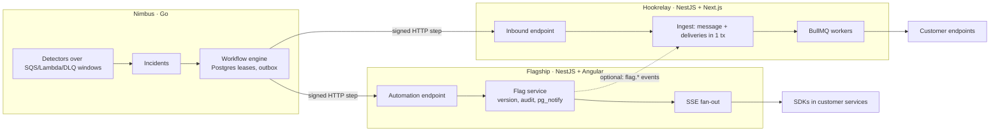

# Atalaya architecture

## Shape

Three codebases, three PostgreSQL databases (plus Redis for Hookrelay), one Docker network in `compose.yaml`. Nothing is shared except a signing secret.

## Integration contracts

### Nimbus → Flagship: `POST /automation/nimbus/flags/{key}/envs/{env}`
- Body: the Nimbus incident event (`incidentId`, `event: opened|recovered`, `pipelineName`, `summary`, …).
- Auth: `Nimbus-Signature: t=<unix>,v1=<hex>` = HMAC-SHA256(`NIMBUS_WEBHOOK_SECRET`, `<unix>.<raw body>`). Rejected outside ±300 s. Several `v1` values allow secret rotation.
- `opened`: if the flag is on, turn it off through the normal write path (validation, version bump, audit entry `killed by nimbus incident <id>`, `pg_notify`, SSE). Already off → no-op.
- `recovered`: restore the configuration from before that kill **only if the latest audit entry is still that kill**. Otherwise no-op.
- Always `200` with `{ changed, action | reason }`, so a workflow step succeeds on replays.

### Nimbus → Hookrelay: `POST /v1/inbound/nimbus/{appId}`
- Same signature scheme. The incident becomes a message `incident.opened` / `incident.recovered` for that tenant.
- Idempotency key `nimbus:<incidentId>:<event>`: a replayed step returns the original message and schedules nothing.
- From there it's ordinary Hookrelay delivery: per-endpoint Standard Webhooks signature, retries with backoff, circuit breaker, DLQ, replay.

### Flagship → Hookrelay (optional): `POST /v1/messages`
- After each committed flag change: `flag.created | flag.updated | flag.archived`, bearer API key, idempotency key `flagship:<type>:<flag>:<env>:<version>`.
- Fire-and-forget after COMMIT with a 3 s timeout. Never blocks or fails a flag change.

## Failure modes

| Failure | What happens |
|---|---|
| Flagship down when the incident opens | The Nimbus step fails as retryable and is retried with backoff (attempts are visible in the run). The Hookrelay notification is a separate step and still goes out |
| Hookrelay down | The notify step retries. The kill switch is unaffected |
| Nimbus retries a step that already succeeded | Flagship answers `changed: false`; Hookrelay answers `duplicate: true`. No double effects |
| An engineer edits the flag during the incident | On recovery Flagship leaves it alone and says why |
| Customer endpoint down | Hookrelay retries, then parks the delivery in the DLQ for replay |
| Signing secret leaked | Rotate: all three accept a previous secret during the overlap (`v1` list / `NIMBUS_WEBHOOK_PREVIOUS_SECRET`) |
| Forged or replayed request | 401: bad signature or timestamp outside the window |

## Why not merge them
- Different problems, data models and scaling profiles: Hookrelay is write-heavy and queue-driven, Flagship is read-mostly with long-lived streams, Nimbus is a scheduler and state machine.
- Different stacks on purpose (Go for Nimbus, TypeScript for the other two): integration through contracts is what makes that a non-issue.
- A merged codebase would turn three clear products into one unclear one, and every release would become a coordinated release.

## Running in AWS
Each product deploys on its own (ECS Fargate + RDS; Terraform in each repo). To connect them, expose the two automation endpoints through each product's ALB, set the same `NIMBUS_WEBHOOK_SECRET` in the three secret stores, and add the Flagship and Hookrelay hostnames to Nimbus' `NIMBUS_OUTBOUND_ALLOWED_HOSTS`.
